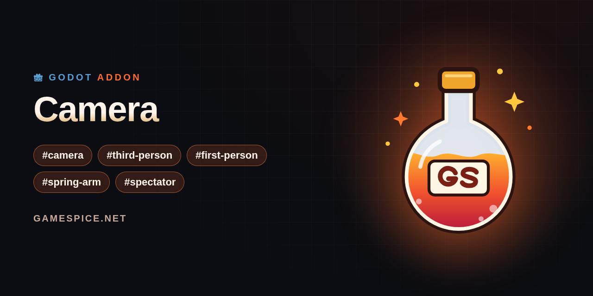

[](https://moddingcommunity.com/a/140-gs-camera)

Godot 4.7+ addon for cameras: first person, third person, orbit and spectator rigs, a collision-aware spring arm, smoothing, field-of-view rules and shake applied from values GameSpice FX computes. Part of the [GameSpice](https://github.com/gamespice-platform) family. It needs only [GameSpice Core](https://github.com/gamespice-platform/core).

This first slice is the rules every rig shares, as pure functions and small state objects: frame-rate independent smoothing, field-of-view rules (speed widening, aim zoom, clamps, vertical and horizontal conversion) and the maths of an orbit camera. The collision-aware spring arm is GameSpice Core's `GSCameraBoom`, and this addon builds on it rather than copying it.

## Install

1. Copy `addons/dot_camera/` and `addons/dot_core/` into your project.
2. Enable dot-camera in *Project > Project Settings > Plugins*.

## Quick start

```gdscript
var cfg: GSCameraConfig = GSCameraConfig.from_files().value
var orbit := GSCameraOrbit.from_config(cfg)

func _process(delta: float) -> void:
    orbit.look(cfg, -mouse_delta.x * 0.003, -mouse_delta.y * 0.003)
    var wanted := orbit.transform_at(cfg, player.global_position + Vector3(0, 1.6, 0))
    camera.global_position = GSCameraSmoothing.damp_vec3(
        camera.global_position, wanted.origin, cfg.position_half_life, delta)
    camera.global_basis = wanted.basis
    camera.fov = GSCameraSmoothing.damp(camera.fov, GSCameraFov.target(cfg, player.velocity.length(), aiming), 0.08, delta)
    camera.position += GSCameraOrbit.shake_offset(cfg, fx_shake_offset)   # from GameSpice FX
```

```gdscript
# a roaming camera and a 2D follow, as pure values
var free := GSCameraFreeLook.new()
free.seed_from(camera.global_transform)
free.look(mouse_relative * 0.002)
camera.global_transform = free.step(cfg, Vector3(right, up, forward), fast, slow, delta)

var zoom := GSCameraZoom2D.zoom_for(cfg, target_radius)
pos = GSCameraZoom2D.follow(cfg, pos, target_pos, delta)
pos = GSCameraZoom2D.clamp_centre(pos, GSCameraZoom2D.half_extent(viewport_size, zoom), arena)
```

## Settings

Every number is a field on `GSCameraConfig`. The values below are defaults, and the ranges are inspector slider limits, not enforced caps. Set the property from code or a config file to go beyond them.

| Setting | Default | What it does |
| --- | --- | --- |
| `enabled` | true | Off, the rules return the base field of view. |
| `mode` | 0 | 0 first person, 1 third person, 2 orbit, 3 spectator. |
| `fov` | 75.0 | Vertical field of view at rest, in degrees. |
| `fov_speed_add` | 8.0 | Degrees added at full speed; 0 is a fixed field of view. |
| `fov_speed_full` | 9.0 | Speed in metres per second at which the add is complete. |
| `fov_aim_scale` | 0.7 | Multiplier while aiming. |
| `fov_min` | 30.0 | Lowest field of view returned. |
| `fov_max` | 120.0 | Highest field of view returned; 0 is no upper clamp. |
| `position_half_life` | 0.06 | Seconds to cover half the distance to the target; 0 follows exactly. |
| `rotation_half_life` | 0.0 | The same for rotation. |
| `distance` | 3.5 | Metres behind the pivot. |
| `distance_min` | 0.8 | Closest zoom. |
| `distance_max` | 8.0 | Furthest zoom; 0 is no limit. |
| `pitch_min` / `pitch_max` | -80 / 80 | Pitch limits in degrees. |
| `shoulder` | 0.0 | Sideways offset in metres. |
| `shake_scale` | 1.0 | Scales shake from GameSpice FX; 0 is off. |
| `free_speed` | 8.0 | Metres per second of a roaming camera. |
| `free_fast_scale` | 3.0 | Speed multiplier while the fast key is held. |
| `free_slow_scale` | 0.25 | Speed multiplier while the slow key is held. |
| `follow_2d_half_life` | 0.08 | Seconds for a 2D camera to cover half the way to its target; 0 snaps. |
| `zoom_2d_reference` | 32.0 | Target radius at which 2D zoom is 1; 0 turns size-based zoom off. |
| `zoom_2d_exponent` | 0.5 | Zoom falls as radius to this power. |
| `zoom_2d_min` | 0.18 | Lowest 2D zoom. |
| `zoom_2d_max` | 2.0 | Highest 2D zoom; 0 is no cap. |

Layers, weakest first: the defaults, `cfg/addon/dot_camera/*.yml`, the game's files, the operator's files, `DOT_CAMERA_*` environment variables, then `--camera-*` flags.

## What it is not

- Not the spring arm: GameSpice Core ships `GSCameraBoom`, `GSCameraProbe`, `GSCameraFade` and `GSCameraCheck`. Use them; this addon adds the rules around them.
- Not look input: GameSpice Player Controller accumulates look and owns its first and third person rigs. They can use these rules.
- Not shake: GameSpice FX computes the offsets and never touches a camera; this addon only scales and applies what it computes.
- Not spectating: GameSpice Spectate owns observer modes, target choice and who may watch whom. `mode` 3 here only selects the rules.
- Not seats: GameSpice Vehicle owns seats and the cameras bound to them.

## Licence

MIT.
